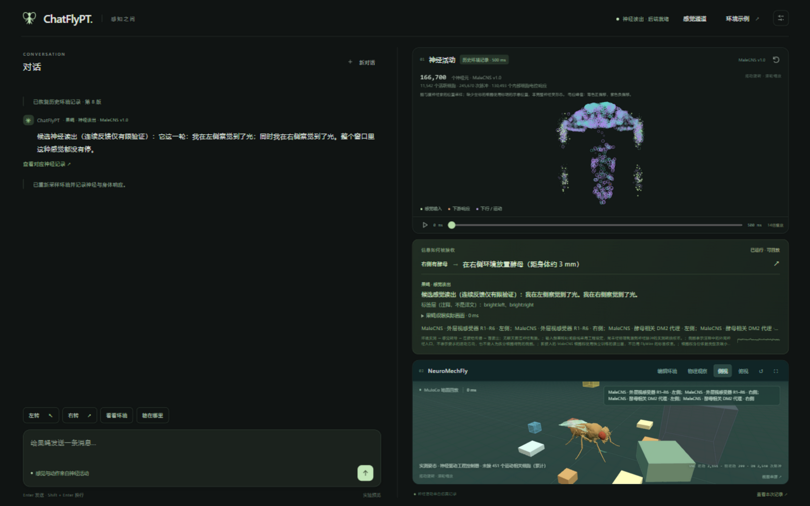

# ChatFlyPT

当前界面：人的消息 → 物理环境呈现 → 实测眼图／位置／接触 → 感觉转导 → 连接组活动 → 盲读出的有限标签 → 聊天框中的自然语言。正常聊天禁止绕过环境直接注入神经事件；人的“左转”呈现为右前腿物理碰撞探针，测得实际接触后才有触觉输入。糖等物品放入真实场景，未接触不能产生味觉。直接神经干预仍在明确标记、独立于聊天会话的实验面板中。

按 chetaslua 公开演示的内部活动读出路线独立重建，不要求先模拟物理发声。输入翻译和感觉证据显示在“信息如何被接收”，身体由记录到的运动相关活动驱动。正常环境通路现使用单个 MaleCNS 脑与身体；持续环境试次的语言标为候选读出，未知、无活动或对应反馈读出未通过验证时保留无回复。旧的独立连接组实验另行标识。**不调用 GPT/Qwen 代替果蝇说话或决定动作，不发送模型建议回传。** 这不是任意语义已破译，也不声称取得了作者未公开的完整代码。

当前单模型通路与真实物理验收见 [统一通路](reports/unified-pathway-20260924/README.md)、[MaleCNS 感觉入口](reports/malecns-senses-20260924/README.md)及[统一读出验收](reports/unified-readout/README.md)。环境通路的统一盲读出器现为 `conspecific-v5` 批次（2026-09-30 发布）：并集语料 141 会话 / 294 窗，**18/30 标签合格**，留出测试 98 窗 micro-F1 0.956、零输入假阳性 0、物理失败 0。相较上一批新增的正是两个同种模态——**cVA 与求偶鸣声现在能读出**（`cva:left/right`、`auditory:left/right`），靠的是**借用上游羽流网格 + 让源跟随受体**这两个投递修复，而不是放宽门槛。环境呈现仍有模态缺口；下述历史直接神经实验的通道数量和识别成绩，不代表全部通道已有物理环境转导。

同一天还接入了三件同种通信与读出的事，都按"只用实测的东西"落地：

- **触碰节奏**：物理探针支持敲击序列（次数、开启到开启间隔、每次按当前腿姿重新瞄准），呈现层报告**实测到几次接触**而不是窗口数；语言支持"连碰三次""碰三下"。同种接触的毫秒级时长在可及文献中查不到，因此时序是**工程参数**，不是实测值。
- **cVA 信息素与求偶鸣声**：在同一个 MaleCNS 个体上新增 `mc_cva`（`ORN_DA1` 204 个细胞）与 `mc_auditory`（官方听觉子类 114 个细胞）两个候选入口，采样点分别是实际的 funiculus（Or67d 所在）与 pedicel（约翰斯顿氏器所在）；腿弦音器明确**不**当听觉用。两个源是非实体工程场，落点检查通过（零接触、初始位姿不变、初始场单侧）。**2026-09-30 起这两个模态可以被读出**：`cva:left/right` 与 `auditory:left/right` 已通过资格门槛，靠的是两个投递修复——**借用上游羽流网格**（flygym-gymnasium `plume_short.hdf5`，Apache-2.0）与**让源跟随实测受体位姿**——而不是放宽门槛。证据链与借用出处见 [同种信号通道](research/conspecific-channels-20260929.md) 与 [借用清单](research/borrowed-upstream-code.md)。
- **运动意图读出**：新增一条与感觉读出**并列且分开显示**的读出（接收框"果蝇 · 运动意图（候选）"），特征用同一套盲掩码，标签只来自**实测身体结果**（同窗偏航变化与路径长度）。当前版本（连续向量回归，思路借自 vendored flyvis 的解码头）**只合格了位移分量**：线上会说"它在走动／它基本停着不动"，**不会说转向**。转向读不出的根因已查清（见 [运动侧读出](reports/intent-readout/README.md)）：偏航主要由身体动力学/滑移决定（无驱动窗口标准差 3–7°，极值 ±20–59°），而被驱动的不对称只带来 ~0.3°；系留飞行在上游控制器里是**写死的零驱动**，拿不到行为数据。要让它成立必须改运动通路，属需单独立项的决定。它必须与"身体由固定工程控制器驱动"这条限制一起读：该读出部分反映的是那个控制器的映射，不是已证明的内在意图。
- **组合式表达（生成式那一步）**：感觉读出那一行不再只是逐通道模板，而是按"**内部活动 → 各感觉通道 → 时间形态**"组合成句，措辞在 2–3 个变体里确定性选择；槽位全部来自盲读出，渲染器**不能**增加事实。conspecific-v5 测试集 98 窗实测：**61 个不同句子、0 虚构槽位、0 无实测支撑、12 条被实测反驳（12.2%）**——每条矛盾都带实测值留档。没有槽位读出时自动回退旧模板（作者示例句逐字不变）。详见 [接地生成式渲染器](reports/generative-renderer/README.md)。**本层不含语言模型**：用预训练 LM 说话只能作为单独标注的实验，不进聊天。

方法上借了田野语言学处理欠描述语言的做法：语料按"语境/实测接收/内部活动/行为结果"四层分离并留索引，每个条件写成"问题 + 最小对立对 + 判定标准"的诱导题库，被否定与未合格的结论集中进 [负证据登记册](reports/corpus/negative-registry.json)，语料配[数据声明](reports/corpus/data-statement.md)，逐会话一致性与弃权分开报告。产出物的定位是"素描语法 + 空白清单"，不是"果蝇词典"。

完整组件职责与要求见 [架构约定](research/chatflypt-contract.md)。此前接入的外部建议链路已撤下。本轮环境与输出分离见 [环境验收](reports/environment/README.md)。前轮纠正记录与实际输入测试见 [神经表达模式验收](reports/neural-expression-only-2026-09-20/README.md)。

**这不是取得作者源码后的精确复现。** 原作者完整词表、编码、权重和环境尚未取得；本实现的假设和未完成项分别记录。

## 历史独立实验实测

以下数字属于各自存档的独立神经干预、旧连接组或旧反馈版本。当前单个 MaleCNS、环境实测通路的验收单列于 [统一通路报告](reports/unified-pathway-20260924/README.md)，旧成绩不作为当前版本成绩。

通用输入现有 **37 个主要感觉通道**，包括分别映射的糖、水、高盐及己酸候选。界面显示实际脉冲及阈下膜电位峰值，并可用测得的运动活动驱动 MuJoCo 身体。386 个可执行通道中，370 个有内部电响应；主通道37/37。其余数据缺口有逐项原始资料溯源，不能等同全部果蝇生理已复原。最新验证见 [缺口修复报告](reports/gap-closure/RESULTS.md)；[前轮通用输入报告](reports/general-sensory/RESULTS.md)与下面的16词结果保留为历史协议。

完整通路新增：MaleCNS 脑与腹神经索模型包含 **166,700 个神经元、24,559,135 条建模连接**。左右/双侧/空白触碰独立测试 **39/40**，未见过的强度 **26/32**；cVA/鸣声/空白独立测试 **30/30**。读出排除全部感觉细胞及直接输入细胞。切断前腿感觉细胞出边后，内部活动和触碰读出均归零。详见 [完整通路报告](reports/full-pathway/RESULTS.md)。

连续环境读出另补 **18 段会话、48 个 500 ms 窗口**，按整段会话划分训练、验证及测试。原留出测试的光照/酵母整组标签由 **4/8 提升到 8/8**，左右前腿触碰及撤除保持 **8/8**；推理仅接受内部神经记录。**后续热源反例显示 FlyWire 适配器会误报酵母，已停用并回退基础读出**，历史 8/8 不代表新场景泛化。基础读出仍有误报，所有持续反馈聊天保持候选说明。参见 [原连续反馈验收](reports/feedback-readout/README.md) 和 [糖与强刺激实测](reports/sugar-pressure-20260924/README.md)。

| 展示例子 | 结果 |
|---|---|
| 糖 / 糖+苦的 MN9 放电 | 10 次 × 1 秒：平均 **85.9 → 9.4 Hz**；方向一致，未复现 78→3 Hz |
| 16 个代理词单词识别 | **96/96**；排除感官输入神经元 |
| 仅下行/运动神经元读出 | **91.7%** 单词准确率 |
| 醋+酵母+糖+温暖+明亮完整句子 | **20/20**；该组合未进入训练/验证集 |
| 听觉编码 → 下游读出 | **37/37**；工程码本和外部读出器，不代表原生左转 |
| 原生 DNa01/DNa02 左转响应 | **未证明**；左编码的 37 次试次中左右活动均相同 |

听觉编码的玩具环境闭环轨迹、觅食与真实大模型建议回传实验已于 2026-09-28 连同其代码一并移除；上表只保留仍可从 [完整结果](reports/reconstruction/RESULTS.md) 复核的神经侧测量。当前实现不含“读出 → 建议 → 回灌神经”链路。

[完整结果](reports/reconstruction/RESULTS.md) · [机器可读验收](reports/reconstruction/acceptance.json) · [方法与假设](research/reconstruction-method.md)

历史展示脚本的输出（包含固定提问结尾，当前聊天不会添加它）：

> I smell vinegar and yeast. I taste sugar. It is warm and bright. What should I do?

感官词来自神经活动盲读出；提问结尾是固定模板。醋、酵母等使用已注明限制的刺激代理。

## 启动界面

在项目目录 PowerShell 中执行：

```powershell
powershell -ExecutionPolicy Bypass -File scripts\start-chatflypt.ps1
```

打开 <http://127.0.0.1:8765>。桌面采用左右各半布局：左边为聊天，右边依次是神经活动图、信息接收框和果蝇观察空间。



- 用户输入“左转”或“请你往左转一下”，中间接收框显示“用真实碰撞探针尝试触碰右前腿”及实测接收结果。仅测得实际接触才产生触觉输入，不保证接触或转向。否定、假设、未映射角度或夹带未知指令不会被截断执行；“一下”不代表已标定的转角或触碰强度。“连碰三次”“碰三下”等多回合敲击会转成**探针敲击序列**，接收框报告实测到几次接触（而不是 10 ms 窗口数）；敲击时序是工程参数，不是实测的生物接触时长。
- “释放信息素”“播放求偶鸣声”会把对应的**非实体工程场**（cVA 源 / 鸣声源）放进场景，位置固定、强度可调；是否收到由实测场强决定，远源不产生标签。场强不是浓度或声压，鸣声的时间结构按文献示例的 36 ms 脉冲间隔由受体编码器施加。
- 感觉描述通过通用解析器组合通道、侧别、强度和时间；“停止输入”撤除人的提示，实际环境仍会产生感觉反馈。普通提问可重新表达已有盲读出，标明来自上次记录；有场景含义的查询按场景解析规则处理，不能冒充任意问题已被理解。未知/未映射刺激明确显示未执行。正常聊天中的糖词只改变物理场景；MaleCNS LB3b/c、LB3a 及历史 FlyWire 糖水联合群保留在独立神经干预实验，不能在聊天中绕过实际感受器接触。
- 点击“感觉通道”查看完整目录、身体入口和覆盖缺口，可直接添加多项输入。前后上下或现实物体位置到外周感受器的转换仍未校准。
- 点击“环境示例”添加十类物品虚影（含 cVA 信息素源与求偶鸣声源）；在“编辑环境”中拖动平面位置，编辑 XYZ、尺寸、Z 旋转、强度及影响半径。应用后运行环境采样、神经和物理试次，在聊天框显示“环境改动”。“实验设置”另保留原 16 词直接刺激协议，它是离线刺激实验。
- “果蝇 · 感觉读出”及输入翻译位于接收框；聊天显示“果蝇 · 神经读出”，把内部神经活动盲读出的有限标签转换成第一人称文字。读出按**两层**显示：标签层是注释（判读出的标签本身），译文层是那句第一人称文字——注释不等于译文。无活动、未知或入口未校准时保留无回复。持续反馈标签仍为候选，不生成行动建议或建议回传。现有演示组合的 20 次新试次和网页接入见 [神经语言验收](reports/neural-language-route/README.md)。当前发布件（v8 联合语料，v5+v6+v7 共 654 窗）**20/30 个标签合格**：新增 **升温左/降温左/降温右** 三个侧别标签（验证集 precision 0.93–1.00、recall 0.78–0.88），**酵母两个侧别标签落榜**——不是缺数据：v5 里那条“酵母：右”其实是“有酵母气味”检测器（当时语料偏侧），换成两侧等量的语料后它读不出左右，我把“阈值尺度”这个解释也实测排除了（改用按训练分位数取阈值，结果不变），因此如实记为未读出。
- 接收框另有一行“果蝇 · 运动意图（候选）”：它由**内部活动**预测这只果蝇**自己正在做的运动**（走/停，以及转向分数合格时才有转向），标签只来自实测身体结果，与感觉读出分开显示、独立弃权。它必须和“身体由固定工程控制器驱动”一起读——候选预测不等于已证明的内在意图。转向标签在“实测运动”这条线上仍然弃权，说明与失败记录见 [运动侧读出](reports/intent-readout/README.md)。
- 接收框还有一行“果蝇 · 自身下发的转向指令（候选）”，与上一行**分开**：读的是**它自己下发的**踏步驱动不对称（记录到的命令），不是身体有没有转过去。特征在盲掩码之外**再排除全部已映射运动群细胞**（命令是这些群速率的纯函数，读它们等于复述固定公式），并以“仅运动群”拟合作为天花板对照；方向词（左/右）来自**合成命令实测标定**（不对称 0.34–0.76 时身体 500 ms 内实测转 22–46°，右>左 ⇒ 左转），不是假设。定向诱导轮（v5+v6 共 438 窗）把左转命令从 1 个有效窗补到 6 个，但**读出不行**：验证集 4 个左转窗符号正确率 0/4，右转 26/27——因此“向左”**不发音**（方向门槛要求该方向在验证集既有支持、符号正确率又过线），线上只说“向右”。详见 [命令读出](reports/command-readout/README.md)。
- **跟随源（anchored）已修**：源现在只跟随**自己声明的那一侧**受体（`anchor_side`），真机验证本侧 8–18 个实测事件、对侧恒为 0（旧行为是两侧同强）；未声明侧向的旧场景逐字节不动，记录里标为 `legacy_bilateral`。因 `environment.py` 在契约哈希内，这一改动触发**整批重采**（`conspecific-v9`，393 集 = 原联合 321 + 54 个声明侧向跟随源 + 18 个镜像转向合刺激），四条读出全部重拟合、按门槛发布：**感觉读出 19/30**（新增"冷左/冷右/热左"，落榜"酵母左右"与"热右"——两侧等量后它们稳定读不出）、**命令读出**（右转验证符号 36/36、零误报 0/138 与 0/135；左转仍弃权）、**槽位**合格、**运动意图不合格 → 如实弃权**（不再用旧权重）。工程核查见 [side-delivery-probe.json](reports/unified-readout/side-delivery-probe.json)。
- **提问只回答实测项**：走/停、转向指令、感觉读出、实测接触、实测身体状态各自路由到**测量它的那一条读出**，答案句里带“（据上一轮实测记录 · 读出名）”；该读出弃权就回“本轮没有可用的实测结果：<原因>”，问句形状本身**不算理解**，未知问题仍按未解决输入拒绝（LLM 不在回路里，也不会重跑仿真）。界面上这类回答标为“据上一轮实测记录 · 未重跑仿真”。实况验收：`scripts/check_question_route.py` → `reports/command-readout/question-route-acceptance.json`。
- 接收框可展开本轮官方双眼画面。物体可被看见不等于已尝到化学成分。糖实际接触跗节时有分腿、分侧的 MaleCNS 候选入口，未精确到感器或标定强度；胫节味觉、腿部高盐仍缺可靠桥接。官方身体尚无已注册的 labellum 味毛表面，粗口器碰撞仅记录为未映射，不能冒充唇部糖/高盐输入。每眼 721 小眼的局部亮度通过作者 MaleCNS 光轴、同 body ID 的列交叉表和实际眼相机方向，映射到 2,322 个 R1–6 细胞（左 713、右 1,609）；1,055 个证据不足或超出视场的细胞拒绝映射，不补眼均值。真实亮斑渲染检查 40/40 命中预测小眼；这是几何检查，尚非个体感受野、生理增益或物体身份识别。来源与版本不确定性见 [光轴配准记录](research/retinal-registration-followup-20260924/README.md)。
- 神经图支持拖动旋转、滚轮缩放、暂停和时间轴。正常聊天固定为 MaleCNS，独立实验可显示另一连接组；位置来自注释，缺坐标的细胞标为示意位置，连线取自实际连接；展示采样细胞，不是完整神经突形态。
- “查看通路”和“查看本次记录”提供细胞 ID、输入状态、下行细胞活动与实验依据。身体区域复用 Bad Apple Fly 的 Three.js 视图，显示实际 MuJoCo 三维姿态，支持侧视、俯视、旋转与全屏；时间轴与神经记录同步。
- 动作默认使用 Bad Apple Fly 原始 13 组功能读出、官方 HybridTurningController，以及梳理、口器、翼部等姿态程序。直接刺激的细胞不参与动作读出，已完成时间窗的神经活动才能驱动后续物理步。正常聊天持续运行实际身体和感觉反馈，即使没有可执行命令也保留重力、姿态维持及实际接触；独立无身体试验才显示初始模型。零神经命令时的主动站稳或被动位移不是自主动作证据。
- “实验设置”可选择地面接触或系留振翅。系留模式固定胸部，不含自由飞行气动力。原作者的动作增益和姿态程序也未做生物学校准；复用控制器不意味着已经验证自然行走或语言理解。[接入与同记录对照](reports/behavior-reuse-2026-09-19/README.md)。

当前正常聊天的模型、状态延续、真实 HTTP 和网页验收统一记录于 [当前通路验收](reports/unified-pathway-20260924/README.md)；原控制器接入对照保留在 [历史接入验收](reports/behavior-reuse-2026-09-19/INTEGRATION.md)。

此前保存的远程 API 配置、密钥和下载的本地模型保留，供独立历史实验使用；它们不接入当前果蝇对话/动作通路。本地推理服务已停止，正常启动界面不会启动它。

正常聊天每 10 ms 测量身体与接触、每 100 ms 渲染官方眼图。223 个 claw/club 候选本体入口接收实际腿角/角速度；钙活性到事件率仍为未标定工程增益，负荷记录尚未编码为 campaniform 神经响应。消息之间及物品增删移动均保留神经、身体和控制器动态状态，等待消息时暂停。新对话、更换地面/系留场景及服务重启会初始化；独立实验仍重置。会话最多记录 60 秒仿真时间，达到上限明确停止。详见[统一通路验收](reports/unified-pathway-20260924/README.md)和[本体感觉来源](research/proprioception-bridge-20260924.md)。

有限标签到自然语言已接入，不等于任意人类语义已破译。空间视觉配准、味觉入口与语义覆盖、开放语义码本以及动作的生物学校准仍有缺口；动态状态延续不等于长期学习或突触可塑性。

## 历史展示实验（与当前界面分开）

下面保留此前为核对公开演示编写的神经侧实验脚本及结果，它们只做盲读出，不含模型调用或建议回传。与模型有关的环节已于 2026-09-28 删除，脚本不再接受 `--provider`／`--llm-only`。

```powershell
# 重新运行神经侧重构实验（句子读出与听觉编码读出）
.\.venv\Scripts\python.exe -m chatflypt.demo

# 刷新结果报告与图片
.\.venv\Scripts\python.exe -m chatflypt.report
```

API 失败曾记录为 `unavailable`，不生成伪造模型回答；该记录入口已移除。

从头运行：

```powershell
.\.venv\Scripts\python.exe -m pip install -r research\requirements-reconstruction.lock.txt
powershell -ExecutionPolicy Bypass -File scripts\reproduce.ps1 -Workers 4
```

776 次语料生成在本机约 11 分钟，结果有指纹缓存。脚本只跑神经侧阶段，不再要求任何外部模型测试。

单独阶段：

```powershell
.\.venv\Scripts\python.exe -m chatflypt.verify
.\.venv\Scripts\python.exe -m chatflypt.experiment verify-full
.\.venv\Scripts\python.exe -m chatflypt.experiment physiology
.\.venv\Scripts\python.exe -m chatflypt.experiment generate --workers 4
.\.venv\Scripts\python.exe -m chatflypt.experiment train
.\.venv\Scripts\python.exe -m pytest tests -q
```

## 实现和数据

社会信号输入支持左右前腿触碰候选群、cVA 信息素和求偶脉冲鸣声。腿触碰在独立 MaleCNS 引擎执行，信息素/鸣声在 FlyWire 执行；各用匹配的内部活动读出器。原有 16 词实验保留。接收细胞依据公开注释和文献筛选；刺激强度与 MaleCNS LIF 参数尚未做生理标定。

```powershell
.\.venv\Scripts\python.exe -m chatflypt.social encode --message "模拟右侧触碰"
.\.venv\Scripts\python.exe -m chatflypt.social verify
# 在原 FlyWire 数据与 16 词权重准备好后，重建新增完整通路
powershell -ExecutionPolicy Bypass -File scripts\reproduce-pathway.ps1
```

[社会通信研究与实现边界](research/social-communication-inputs.md) · [输入检验结果](reports/social-input/verification.json)

[本轮生物学复核](research/biological-input-audit.md)：湿觉已由误选的 HRN_VP1l 冷觉细胞改为 HRN_VP5 湿觉细胞；旧结果留档，当前 16 词指标由修正后的语料重新训练。作者原帖明确内容与尚未核实的转载方法分别记录。

- 完整 FlyWire v783：138,639 神经元、15,091,983 条带符号连接行；固定 Shiu LIF 参数。
- 自建 Numba 事件传播加速保留全图，通过与 Brian2 固定输入的逐脉冲对照。
- 776 个独立仿真试次；train/validation/test/OOD 分割的混合组合不重叠。
- 脉冲计数平方根变换后进行线性 ridge 读出。全部标注感官神经元和直接刺激细胞被排除；阈值只用 validation 选择。
- MaleCNS v1.0 官方核心表已构建独立图，读取脑和腹神经索的全部有 superclass 注释细胞；未知/调制性递质的 1,023,803 条边未赋予快突触权重。MaleCNS 与 FlyWire 的细胞 ID 不混用。
- 已接入官方 FlyGym/NeuroMechFly 的 MuJoCo 身体；目前神经先运行、身体后回放，没有身体感觉反馈闭环或跨试次生物记忆，也未验证主观体验或语言语义理解。

```text
chatflypt/                  神经引擎、训练、展示、接口与网页
tests/                      动力学一致性、标签隔离与协议测试
data/derived/reconstruction/  语料、读出权重、展示原始脉冲
reports/reconstruction/     实测数据、验收、图、RESULTS.md
research/                  来源、锁文件、方法说明
vendor/                    固定版本上游源码和各自许可（本地）
scripts/                   环境、数据获取、重现和启动脚本
```

[资源调查](research/resources.md) · [源码追查](research/chetaslua-investigation.md) · [后续研究](research/architecture.md)

新机器先用 `scripts/bootstrap.ps1` 和 `scripts/acquire_sources.py` 准备环境/数据，再安装复现依赖锁文件。旧的 `scripts/smoke_shiu.py` 原模型检查仍可运行。上游许可和固定提交见 `research/manifests/sources.lock.json`。

当前扩展重现：`scripts/reproduce-gap-closure.ps1`；身体环境与依赖锁见 [身体报告](reports/body-simulation/README.md)，当前默认控制器及固定神经记录的新旧对照见 [控制器复用验收](reports/behavior-reuse-2026-09-19/README.md)。旧六腿控制器保留用于对照和历史记录，不再是网页默认后端。

2026-09-24 运动补接：在原 Bad Apple Fly / Hybrid 上接入精确注释的六腿胫节屈/伸肌运动神经元，补充未映射运动细胞诊断、无神经命令的物理运动说明及可见性修复。125 项测试与 30 个正式物理窗口通过；强触碰仍无动作，高盐存在递质预测冲突，不能称为完整趋避行为。见 [运动修复实测](reports/motor-repair-20260924/README.md) 和 [生物学与映射依据](research/motor-pathway-audit-20260924.md)。本次更新的服务地址为 http://127.0.0.1:8766/ 。

扩展协议会记录完整试次的内部膜电位，计算量明显大于旧16词实验；已完成试次有按引擎和输入协议指纹保存的缓存。验证完成并启动本地服务后，可运行真实 HTTP 验收：

```powershell
.\.venv\Scripts\python.exe -m chatflypt.gap_acceptance --port 8765
.\.venv\Scripts\python.exe -m chatflypt.gap_report
```

该验收只做 HTTP 通路与模型指纹检查，不调用任何外部模型。

## 许可

代码以 MIT 许可发布（见 LICENSE）。注意边界：MaleCNS 数据、NeuroMechFly 资产、FlyGym 及其余第三方依赖各自按自己的许可获取，见 [VENDORS.md](VENDORS.md)；本项目不含、也不声称包含真实果蝇的实验数据。
