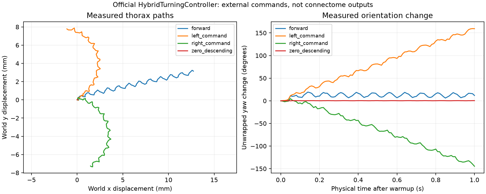
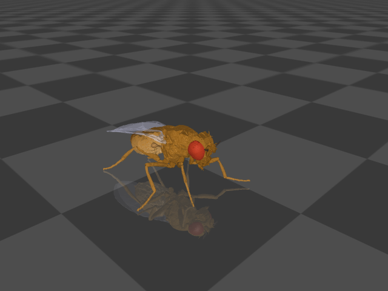

# 官方步行控制器复用核查与本机基线

**官方控制器可以直接复用，本机四个条件已经实际跑通。** 前进、左右转和零命令对照均完成了 1 秒 MuJoCo 仿真，没有数值警告，也没有触发预先定义的摔倒判据。当前缺口不是“没有可用的果蝇步行代码”，而是**把本项目测得的特定神经活动可靠地接到控制接口**；后者不能由复制步行控制器自动完成。

本次只使用现有 `vendor/flygym` 与 `.venv-body`。没有增加依赖、重训脑模型、运行脑仿真、读取 API 设置，或修改生产服务/默认神经到六腿的映射。四组输入均为明确的外部数值命令，不是连接组输出。

## 实际基线

使用官方 `HybridTurningController`、`HybridControllerObservation.from_sim`、`PreprogrammedSteps` 和 `make_locomotion_fly`。模型与初始化沿用官方教程 `4d_turning_controller.ipynb`：seed=0、0.1 ms 物理步长、平地、胫节与跗节地面接触、官方默认关节增益和黏附参数。每个条件独立 reset，先执行教程要求的 **50 ms 主动姿态预热**，再计量 1 秒。预热未被隐藏，也未算入下表的测量时间。

| 条件 | 外部信号 [左,右] | 水平净位移 | 朝向净变化 | 最大身体倾斜 | 摔倒判定 | 物理警告 |
|---|---:|---:|---:|---:|---|---:|
| 前进 | [1.0,1.0] | 13.112 mm | +11.781° | 9.005° | 无 | 0 |
| 左转命令 | [0.4,1.2] | 7.861 mm | +159.345° | 10.449° | 无 | 0 |
| 右转命令 | [1.2,0.4] | 7.405 mm | −144.657° | 10.377° | 无 | 0 |
| 零下行命令对照 | [0,0] | 0.064 mm | +0.364° | 1.827° | 无 | 0 |

正向朝向变化为绕世界 z 轴左转。位移和朝向均由 MuJoCo 实际状态计算，不按命令标签生成。每组保存 101 帧位置、姿态、六足坐标和反馈状态；相同初始条件下各运行约 7.7–8.1 秒墙钟时间。

摔倒判据是本次预先固定的工程诊断：胸部倾斜超过 60°，或胸部中心高度低于 0.5 mm，任一状态连续维持至少 100 ms。四组最大倾斜和最低胸部高度分别保存在 [summary.json](summary.json)，状态全部有限。判据不是自然果蝇行为的生物学认证。

前进确实发生，但有约 11.8° 偏航；左右转幅度也不完全对称。零命令存在小幅漂移，不能描述为数学上完全静止。本轮是单个 seed 的短时平地基线，没有检验长期稳定性、复杂地形或大范围参数鲁棒性。





两张图已目视检查。它们来自真实物理状态；没有生成示意动作补帧。

## 官方代码已经提供什么

| 能力 | 官方实现 | 本次核查/测量 |
|---|---|---|
| 六腿步态协调 | 耦合 CPG、12 Hz 基准频率、官方关节角模板 | 直接调用原版，无重写步态 |
| 左右转向 | 两个下行数值分别调制左右三腿的幅值；符号调制振荡方向 | 两个不对称命令实际产生相反朝向变化 |
| 悬腿回缩纠正 | 读取胸部与六个足端的相对高度 | 原版分支启用；本轮平地未触发，不能声称已实测验证此分支 |
| 绊阻纠正 | 读取胫节、前两跗节的实际接触力，对行进方向做投影 | 前进/左转/右转实际触发 281/107/113 个积分步 |
| 黏附时序 | 依步态相位开关足端黏附 | 原版启用，无另造黏附轨迹 |
| 物理身体 | NeuroMechFly、MuJoCo 关节执行器、地面碰撞、惯性和重力 | 原版模型实际运行，nq=73、nv=72、nu=48 |

因此，身体局部的“物理状态 → 反射控制器 → 关节命令”反馈可以直接复用，不必自己重写。这与“感觉输入 → 全连接组 → 运动输出 → 身体 → 再输入连接组”的完整神经闭环不同；本次没有把这些物理反馈转成连接组的感觉脉冲。

## 与当前生产适配器的差别

`chatflypt/body_simulation.py` 当前调用的是官方 `CPGController` 和关节模板，并使用实际神经脉冲构建的六腿幅值，同时缩放每腿的位置/黏附执行器增益。没有可用运动活动时不生成主动动作。

本次官方基线使用 `HybridTurningController`，增加了上述实际接触/足端高度反馈，但同时也采用教程的完整执行器增益、主动姿态预热、接触配置和人为命令。因此这不是只开关 Hybrid 反射的对照实验，不能把它与之前弱神经驱动的轨迹差异全部归因于 Hybrid 控制器。

尤其需要区分 **`descending_signal=[0,0]` 与“全部执行器关闭”**：官方零命令将 CPG 目标幅值置零，位置控制和黏附仍在工作，必要时仍可产生反射修正。本次零命令的原生执行器数值最大值仍为 40，主要受黏附参数影响；这组是零步行命令的姿态保持对照，不是被动物理对照，也不是“连接组无脉冲”的替代测试。没有测试从行走过程中突然发出停止命令的制动过程。

## 仍需验证的连接层

1. **接口身份。** 官方 `HybridTurningController.step` 只接受两个数值，不指定它们对应哪两个真实神经元，也没有内置 MaleCNS/FlyWire ID 到控制量的配准。接口名 `descending_signal` 不意味着已经完成下行神经细胞的生理映射。
2. **细胞到运动含义。** 当前 MaleCNS 适配器按前/中/后腿运动群及胞体侧别分成六组，尚未逐细胞验证肌肉末梢侧别与支配肌肉；也没有解析拮抗肌的不同作用。把群体脉冲率变成 CPG 幅值仍是工程假设。
3. **信号尺度。** 当前 10 ms 分箱、30 ms 滤波、20 Hz 参考和执行器增益缩放均需通过独立神经刺激/行为数据验证。官方原版步行良好，不能据此证明这些新增转换参数正确。
4. **反馈入口。** 官方接触/姿态纠正是控制器内的规则。若要宣称完整连接组闭环，还需把对应物理量送入有依据的感觉群，并核对时序、单位和活动范围。

可以复用完整官方控制器来代替自己编写身体控制部分，保留清楚的外部命令基线；也可以在隔离实验中评估官方 Hybrid 反馈接到现有六腿驱动后的效果。此次没有替换默认映射，没有用外部“左转”命令伪装成神经网络自主决定。

## 来源、参数与重现

- FlyGym 2.1.0，MuJoCo 3.9.0，Windows x64，Python 3.12.14。
- 官方代码 commit：`38c8ec61034cd59bc5ba0de20688d4a3c0000d60`。
- 官方归档 SHA-256：`3bac51eb25b8c6715172eb898665ceff5a91aa78b088715d7077443faa84380a`。
- 模块实际加载自本地 `vendor/flygym/src/flygym_demo/complex_terrain/turning_controller.py`。
- 协议、八份相关源码/模型文件哈希、全部控制参数及与教程的差别见 [protocol.json](protocol.json)。运行后再次验证这些源码哈希未改变。
- 四组完整数据：[前进](forward.json)、[左转](left_command.json)、[右转](right_command.json)、[零命令](zero_descending.json)；汇总见 [summary.json](summary.json)。

在仓库根目录执行：

```powershell
.\.venv-body\Scripts\python.exe reports/controller-reuse-2026-09-19/benchmark.py
```

脚本只运行预先固定的四个条件，没有模型训练、语义识别、聊天接口或连接组仿真。使用的是官方未修改控制器；基准程序只负责组合模型、提供显式命令、采集状态和生成报告。

官方原始来源：[转向教程](https://github.com/NeLy-EPFL/flygym/blob/38c8ec61034cd59bc5ba0de20688d4a3c0000d60/tutorials/4d_turning_controller.ipynb)、[Hybrid 控制器](https://github.com/NeLy-EPFL/flygym/blob/38c8ec61034cd59bc5ba0de20688d4a3c0000d60/src/flygym_demo/complex_terrain/hybrid_controller.py)、[左右转向接口](https://github.com/NeLy-EPFL/flygym/blob/38c8ec61034cd59bc5ba0de20688d4a3c0000d60/src/flygym_demo/complex_terrain/turning_controller.py)。
