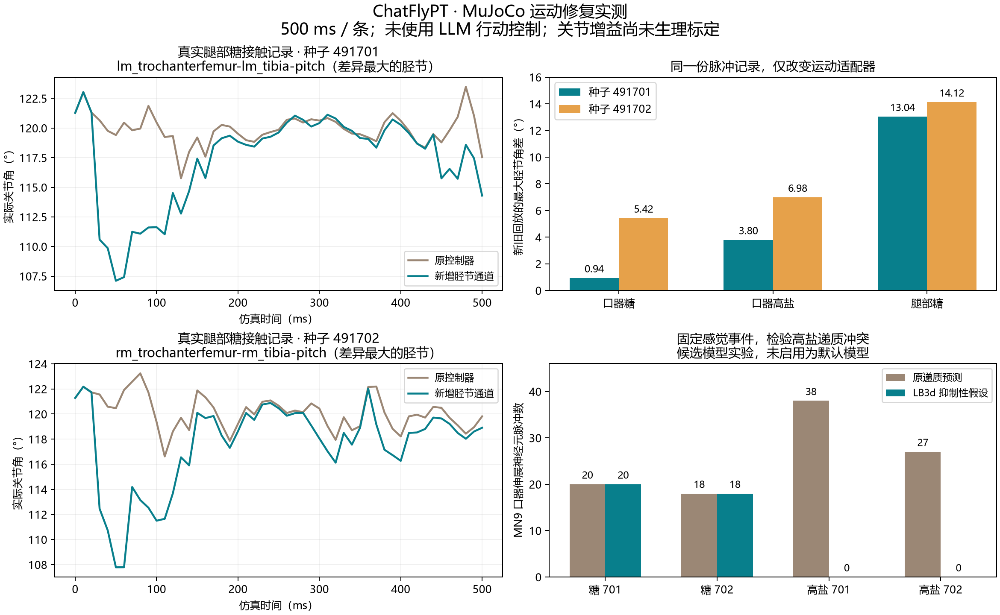

# MuJoCo 运动通路修复与实测

2026-09-24。新增真实腿部运动神经元到六腿胫节的适配，保留原 Bad Apple Fly / Hybrid 控制器；修复无神经命令的物理回放被误述为神经驱动、运动连接缺口不可见，以及小窗口中身体说明被裁切的问题。没有引入 LLM 动作建议或根据感觉标签指定动作。

**本次不宣称完整运动复现。** Fe reductor 缺乏可靠动作/关节映射；高盐的递质身份存在来源冲突，默认模型仍能产生口器伸展。已分别记录这些限制，不把它们掩饰为已完成的逃避反应。

## 实际修改

- `chatflypt/joint_motor.py`：精确匹配 MaleCNS 胫节屈/伸肌运动神经元，按侧别、胸节和出神经连接到六腿。96 个注释细胞；直接输入的细胞排除，FlyWire 不借用 MaleCNS ID。
- 实际脉冲 → 完成的 20 ms 时间窗 → 40 ms 因果平滑 → 有界关节目标。原行为公式与 vendor 文件保持哈希一致。新增角度增益属于工程参数，未经生理标定。
- 对六腿模型几何逐个核对：**正 tibia pitch 使股节—胫节内夹角减小，即屈曲**。控制目标通过 MuJoCo 执行器产生真实位姿，不直接挪动躯干或播放虚构动作。
- `motor_coverage` 列出所有已放电而未接执行器的运动相关细胞及原因。身体状态区和详情显示累计覆盖；无神经动作命令时明确说明仍含姿态维持、重力和环境物理作用。
- 高盐感觉通道的限制中增加 LB3d 递质预测与生物学候选匹配冲突；候选模型仅用于显式消融，不替换默认模型。

## 配对回放：神经记录保持完全相同

种子 491701、491702；每条 500 ms。每个感觉条件分别使用旧适配与新增胫节适配回放，一共 12 条。表中为整个窗口所有胫节中**新旧实际关节角的最大差值**，不是目标角，也不是生物学误差下降量。

| 已记录的感觉条件 | 491701 | 491702 |
|---|---:|---:|
| 口器糖接触 | 0.939° | 5.420° |
| 口器高盐接触 | 3.797° | 6.981° |
| 腿部糖接触 | 13.037° | 14.121° |

所有配对在首个新增运动命令可用之前，关节轨迹逐值相同；之后才出现差异。两次腿部糖的新增通道分别读取 47、43 次真实运动神经脉冲。差异证明适配器确实影响物理关节，**不证明关节增益或趋食动作已经生物学校准**。

## 闭环复测

另跑 10 条独立具身会话：空环境、口器糖、口器高盐、腿部糖、强触碰，各两个种子。每 100 ms 从同一个身体采样环境并反馈到同一神经状态。

- 空环境：两个种子都没有神经动作命令。
- 强触碰：内部脉冲 410、344；能够读出右前腿触碰，仍没有身体动作命令。全身体位置、姿态和关节记录均与同种子空环境逐值一致。
- 两次强触碰均有右前腿 Fe reductor 的 5 次脉冲：806898×2、811652×2、813566×1。模型没有对应独立关节，论文对其功能仍不确定；不将其改接为转向。另有 DNa02 的弱响应，但原控制器只用它调整正在进行的步态，不凭空增加行走基线。
- 口器糖：保持糖候选读出和口器伸展相关神经活动；身体同时接收新增胫节信号。
- 腿部糖：新控制改变实际接触和后续神经反馈；第二个种子的内部脉冲变为 20,660，不能把旧轨迹与新闭环记录混为同一实验。该入口仍未完成感觉语义校准，聊天保留不赋义。
- 高盐：官方递质模型仍有较强 MN9 响应；下述消融单独调查原因，不用身体控制规则覆盖它。

## 高盐递质消融

官方型级共识将全部 26 个 LB3d 标为 acetylcholine；Cell 2026 提出其与高盐相关谷氨酸群的候选匹配。保持归档感觉事件完全相同，只在独立进程内把这些细胞的 1,980 条出边改为抑制性，再运行神经和身体。共 8 条物理回放。后续逐细胞核查更正：个体预测是 11 ACh、7 glutamate、8 unclear，无实验真值；不能把型级共识表述为全部个体预测一致。见 [递质核查](../../research/lb3d-transmitter-followup-20260924.md)。

| 感觉事件 | 原预测下 MN9 脉冲 | 候选抑制性模型下 MN9 脉冲 |
|---|---:|---:|
| 糖，491701 | 20 | 20 |
| 糖，491702 | 18 | 18 |
| 高盐，491701 | 38 | 0 |
| 高盐，491702 | 27 | 0 |

两次糖的全部神经记录保持逐值一致。高盐口器伸展驱动降为 0，但“没有伸口器”不等于“已经实现逃避”。候选细胞身份及完整高盐组合通路仍需验证，默认模型未改变；这个实验也不是独立生物学验证。

## 验收与文件

- **125 项自动测试通过**，包含真实 MuJoCo 验收、六腿几何方向、完成窗因果性、直接输入排除、篡改拒绝、无信号处理和闭环感觉事件的逐值重放。
- 正式实验 **30 个 500 ms 物理窗口**（12 配对回放 + 10 闭环 + 8 递质消融），全部有限、无 MuJoCo 数值警告。
- 本机新版服务运行在 `http://127.0.0.1:8766/`。应用环境版本 5 的 8 个物品保留。服务重启初始化新的动态会话；没有把测试场景覆盖到用户环境。
- 生物学依据与映射边界：`research/motor-pathway-audit-20260924.md`。
- `audit.json`：逐条数值、因果检查、零输入比较、代码及上游哈希。
- `paired-replay.json`、`malecns-results.json`、`salt-transmitter-ablation.json`：完整结果索引。
- 原始记录：`data/derived/motor-repair-20260924/`。包含脉冲、神经状态、身体关节、物体接触、感觉采样及上游控制值。
- `*-pre-axis-fix` 是符号核查前的开发记录，不能作为最终结果。



复测命令（工作目录为项目根目录；应为新实验更换输出目录，现有完整记录有缓存）：

```powershell
.venv\Scripts\python.exe scripts/test_motor_repairs.py replay
.venv\Scripts\python.exe scripts/test_motor_repairs.py closed-loop
.venv\Scripts\python.exe scripts/test_motor_repairs.py salt-sign
.venv\Scripts\python.exe scripts/analyze_motor_repairs.py
.venv\Scripts\python.exe -m pytest tests/test_behavior_readout.py tests/test_behavior_body.py tests/test_joint_motor.py tests/test_neural_session.py tests/test_dialogue.py tests/test_feedback_readout.py tests/test_embodied_physics.py -q
```
