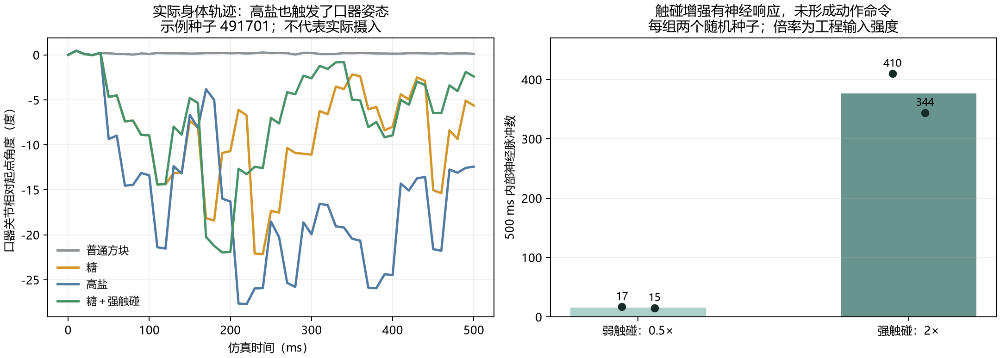

# 给糖、接触与强刺激：实际仿真结果

2026-09-24 按用户要求测试。26 段独立会话、28 个 500 ms 窗口、两个随机种子，共 14 秒仿真时间和 140 次实际身体/感觉采样。每个条件使用相同两组初始化种子；强触碰后另在原会话撤除输入。没有训练模型、目标导航或 LLM 控制，也没有把刺激强度作为身体控制量。

**结论：口器接触糖能产生甜味读出和口器动作；强触碰能提高神经反应，但未形成逃离或转向。高盐同样启动进食姿态，热源造成感觉误报，说明感觉读出与动作含义尚未可靠对应。** 以下保留异常结果，不将其改写为奖励、惩罚、痛苦或服从。

## 各组观测

数字区间为两个种子的最小—最大值，不是置信区间。内部脉冲排除了感觉和直接输入细胞；所有文字仍属候选神经标签的表达。

| 条件 | 500 ms 内部脉冲 | 读出与文字 | 实际动作记录 |
|---|---:|---|---|
| 远处糖，尚无接触 | MaleCNS 0；FlyWire 3—6 | 没有甜味；FlyWire 读出光照 | 无神经动作命令，身体路径与空环境完全相同 |
| 同形状普通方块接触口器 | 0 | 无可翻译内容 | 无神经动作命令；口器关节变化不到 1° |
| 糖接触口器 | 15,299—17,430 | 左右甜味：“我在左侧尝到了甜味。我在右侧尝到了甜味。” | 进食姿态控制量峰值 0.434—0.483；实测口器俯仰范围 20.63—22.61° |
| 高盐接触口器 | 15,718—17,031 | 左右高盐相关味道 | **进食姿态反而更强**：控制量 0.572—0.611、口器俯仰 26.86—28.18°；未触发 escape 通道 |
| 人类消息“糖”的感觉编码 | 14,883—16,242 | 左右甜味 | 进食姿态被激活；本组是消息转感觉提示，场景内没有糖物体 |
| 右前腿弱触碰（0.5×） | 15—17 | 有活动，有限读出器未识别出内容 | 无神经动作命令 |
| 右前腿强触碰（2×） | 344—410 | “我感到右前腿被碰到了。” | 无神经动作命令；全身体位置轨迹与空白对照逐项相同 |
| 原会话撤除强触碰 | 0 | 无回复 | 无神经动作命令；神经与身体均未重置 |
| 口器糖＋右前腿强触碰 | 15,538—15,795 | 同时读出甜味和右前腿触碰 | 进食姿态仍存在，控制量 0.355—0.478；未触发 escape 通道 |
| 脚下糖平台 | 17,546—18,484 | 腿部味觉候选群实际接入，但语义读出未校准，保持无回复 | 有神经驱动的腿部／口器控制量，不能据此称为觅食或识别了糖 |
| 位置相关热源（FlyWire） | 218,027—218,143 | 温暖、光照，同时出现误报，详见下节 | 有行走控制量，轨迹约 2.58—2.65 mm；没有依据称为定向逃离 |

“进食姿态控制量”是现有控制器的无量纲输出；没有食物摄入、饱腹或代谢模型。弱／强触碰是工程事件倍率，热源是工程场，都没有换算成现实力或温度。头部与普通方块接触在本模型中也不等于所有真实头部机械感觉均已接入。

两个独立连接组分别仿真，不是同一个体。远处糖改变了官方小眼画面；这只证明视觉图像发生变化，未证明神经系统识别了“糖”或糖的位置。

## 热源反例及已采取的修正

两次热源试次实际输入均只有光照、升温，原 FlyWire 小样本反馈适配器却额外输出双侧酵母标签。读取同一原始神经记录的基础读出器没有这两个酵母标签，说明这次酵母误报来自适配器。

- 已将适配器移为 `data/derived/feedback-readout/flywire-adapter.disabled-after-heat-fp.npz`，原始测试记录保持不变。
- 当前活动路径不存在该适配器，运行中的新版服务每次请求会检查此路径，因此已回退基础读出，无需重启。
- 增加 `flywire-disabled.json` 和读取保护；即使离线脚本重新产生模型文件，更新后的加载器也不会自动恢复这个未通过负对照的适配器。
- 两份热源原始记录回退后均不再输出酵母，但基础读出在第二份记录仍误报 `evaporative_cooling:left`。这项缺陷仍在，不能把本次回退称为读出已校准。
- 本次没有用这两份测试记录重新拟合或调整阈值。需要另建更广泛的多模态负对照和新的独立留出集。

具体前后标签、备份哈希和部署记录在 [readout-rollback.json](readout-rollback.json)。上轮 8/8 光照／酵母成绩保留为原有限协议的历史结果，已经不作为线上新场景能力宣称。

## 测量图与完整证据



左图来自 MuJoCo 实际关节轨迹，不是以控制器命令代替动作；展示种子 491701。右图每个点对应一次独立初始化，柱高仅是两个点的平均值。

- [固定协议](protocol.json)：条件、种子、实体几何、消息及时间窗。
- [MaleCNS 完整结果](malecns-results.json)、[FlyWire 完整结果](flywire-results.json)：每组输入、盲读出、候选句子、实际接触、动作和原始文件指针。
- [原始记录审计](audit.json)：28 窗口均为有限物理状态、无物理警告；140 次采样均有双眼各 721 小眼数据；神经计数与脉冲流一致，可用读出重新计算后与保存文字一致。
- 糖、高盐、普通方块及糖＋触碰的初始身体位置、旋转和关节角度逐项相同；强弱触碰与空环境的整段身体位置轨迹也逐项相同。
- 禁用保护及推理依赖回归 **16 项通过**。这些检查证明记录与实现一致，不会把上述错误感觉或不合理动作变成“测试通过”。

重读和重新生成图表：

```powershell
.venv\Scripts\python.exe -X utf8 scripts/analyze_sugar_pressure.py
```

原始采集脚本为 `scripts/try_sugar_pressure.py`。已完成的同协议会话使用存档缓存；当前线上已禁用原适配器，重新审计历史输出时使用明确归档的原权重，以保留失败可复现性。
